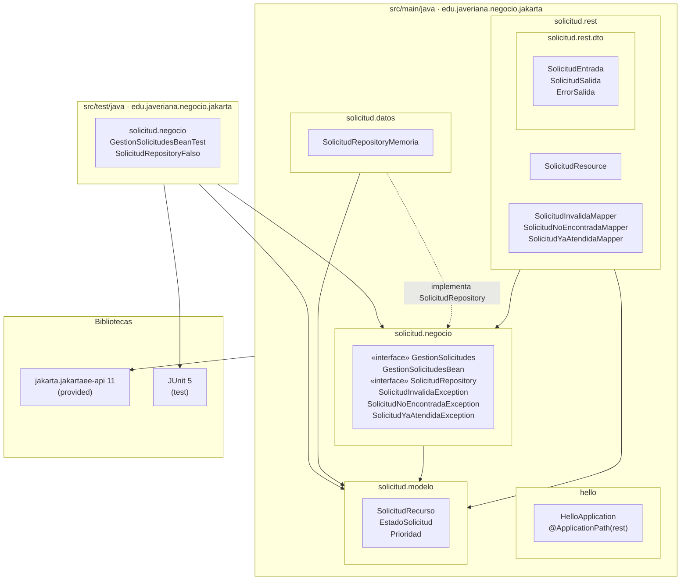
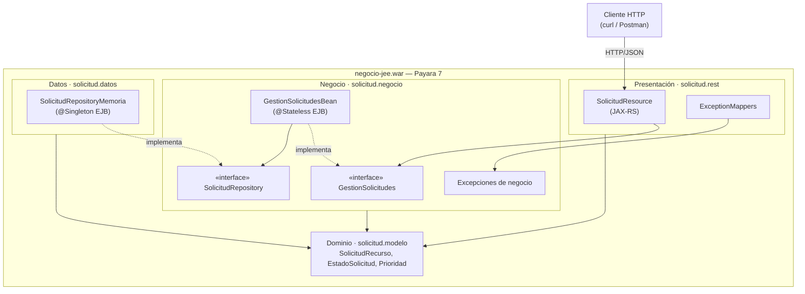
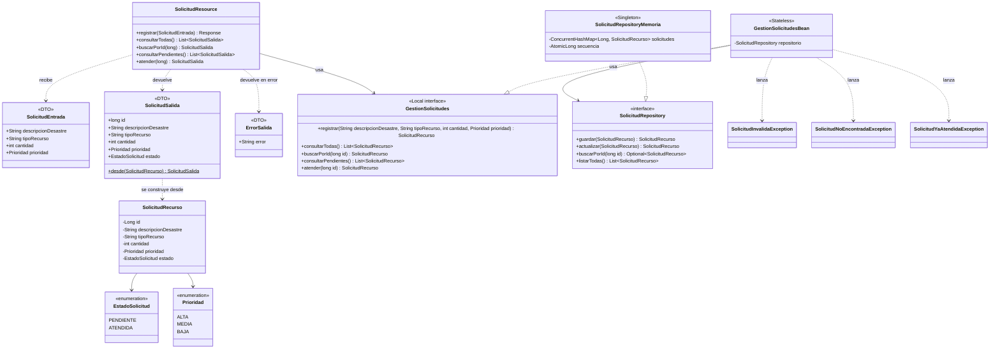
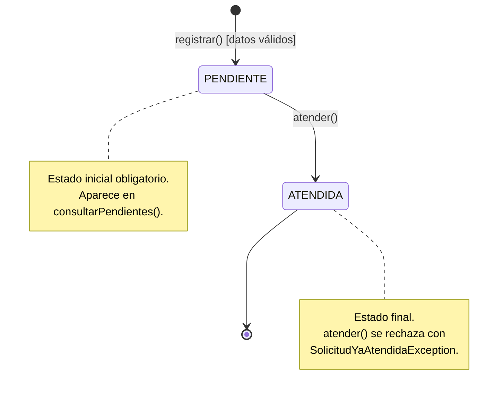
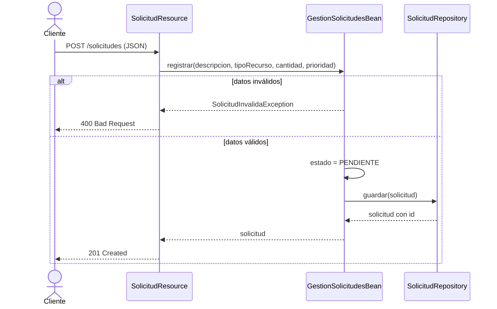
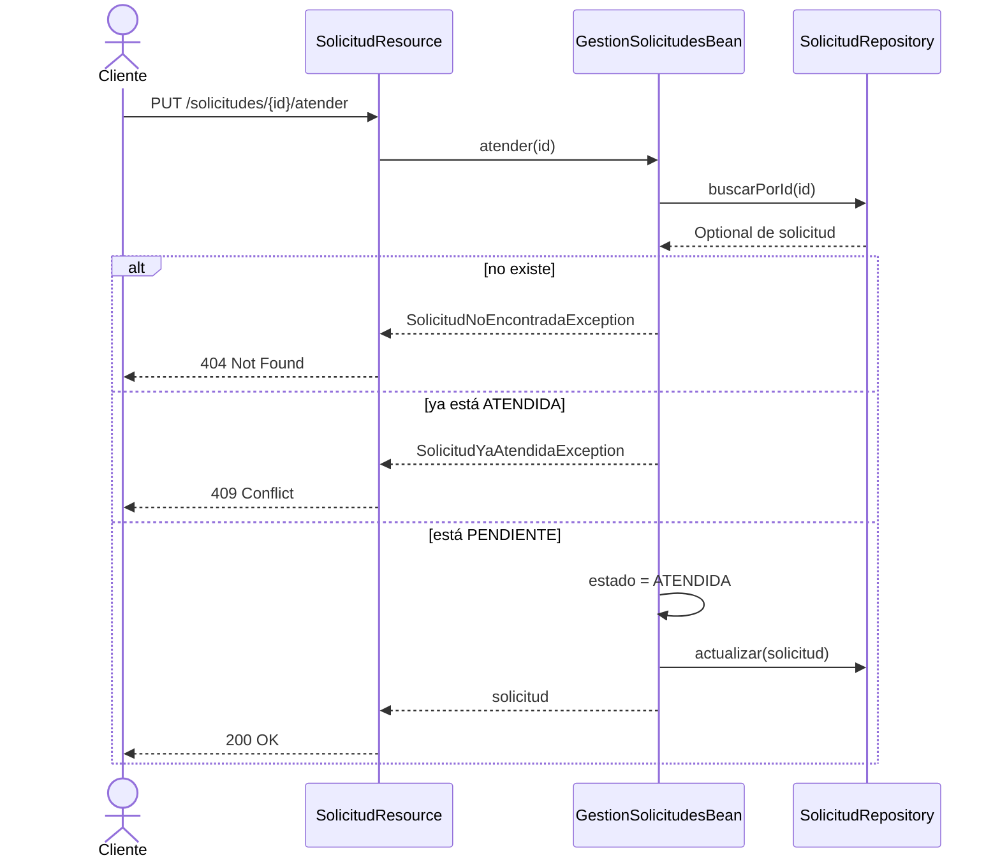

# Diseño de arquitectura — Taller No. 2 Jakarta EE + Tier de Negocio

Pontificia Universidad Javeriana · Arquitectura de Software · 2026-30

## 1. Visión general

El módulo administra las solicitudes de recursos que los centros de atención registran durante
una emergencia (inundación, incendio, deslizamiento). Permite registrar solicitudes,
consultarlas (todas, por identificador y solo las pendientes) y atenderlas.

La solución es una aplicación Jakarta EE 11 empaquetada como un único WAR (`negocio-jee.war`)
desplegado en Payara 7. Internamente se organiza en tres capas lógicas:

- **Presentación (REST):** endpoints JAX-RS delgados que solo traducen HTTP/JSON a llamadas
  al negocio. Existen para poder evidenciar el funcionamiento; no contienen reglas.
- **Negocio (EJB):** un EJB de sesión sin estado que encapsula todas las reglas de negocio.
- **Datos (en memoria):** un repositorio que guarda las solicitudes en una colección en
  memoria.

La regla que gobierna el diseño es que **las dependencias siempre apuntan hacia el tier de
negocio**: la presentación depende del negocio y los datos dependen del negocio; el negocio
no depende de ninguno de los dos.

## 2. Vista de desarrollo

Muestra cómo se organiza el código fuente: módulos, paquetes, dependencias permitidas entre
ellos y cómo se construye el entregable.

Paquete base: `edu.javeriana.negocio.jakarta`.

### 2.1 Diagrama de paquetes

Las flechas continuas son dependencias de uso (`import`); las punteadas indican que un
paquete implementa una interfaz definida en otro.



Dependencias prohibidas, que son las que garantizan el desacoplamiento:

- `solicitud.negocio` no importa nada de `solicitud.datos` ni de `solicitud.rest`.
- `solicitud.modelo` no importa ningún otro paquete del proyecto.
- `solicitud.rest` no importa nada de `solicitud.datos`.
- Los DTO no salen de `solicitud.rest`; el negocio solo conoce el modelo de dominio.

### 2.2 Organización del código fuente

```text
negocio-jee/
├── pom.xml                      Maven · packaging war · Java 21 · Jakarta EE 11
├── Dockerfile                   imagen payara/server-full con el WAR
├── docs/entrega/             arquitectura, informe, diagramas, Postman y evidencias
└── src/
    ├── main/
    │   ├── java/edu/javeriana/negocio/jakarta/
    │   │   ├── hello/           HelloApplication: activador JAX-RS
    │   │   └── solicitud/
    │   │       ├── rest/        SolicitudResource, ExceptionMappers
    │   │       │   └── dto/     SolicitudEntrada, SolicitudSalida, ErrorSalida
    │   │       ├── negocio/     interfaces, EJB @Stateless, excepciones
    │   │       ├── modelo/      SolicitudRecurso, enumerados
    │   │       └── datos/       SolicitudRepositoryMemoria
    │   └── webapp/WEB-INF/web.xml
    └── test/
        └── java/edu/javeriana/negocio/jakarta/solicitud/negocio/
```

Construcción y despliegue: `mvn clean package` compila, ejecuta las pruebas JUnit y genera
`target/negocio-jee.war`; `mvn cargo:run` (o la imagen del `Dockerfile`) lo despliega en
Payara 7.

### 2.3 Capas y colaboración entre componentes

| Paquete | Contenido | Tier |
|---|---|---|
| `solicitud.rest` | `SolicitudResource` (JAX-RS, `@RequestScoped`), `ExceptionMapper`s | Presentación |
| `solicitud.rest.dto` | `SolicitudEntrada`, `SolicitudSalida`, `ErrorSalida` | Presentación |
| `solicitud.negocio` | `GestionSolicitudes` (interfaz `@Local`), `GestionSolicitudesBean` (`@Stateless`), `SolicitudRepository` (interfaz), excepciones de negocio | Negocio |
| `solicitud.modelo` | `SolicitudRecurso`, `EstadoSolicitud`, `Prioridad` | Dominio (compartido) |
| `solicitud.datos` | `SolicitudRepositoryMemoria` (`@Singleton`) | Datos |



El activador JAX-RS ya existente (`HelloApplication`, `@ApplicationPath("rest")`) se
reutiliza, de modo que los recursos quedan publicados en `/negocio-jee/rest/solicitudes`.

## 3. Diagrama de clases



### DTOs

Los DTO son el contrato JSON de la API y viven solo en la capa REST:

| DTO | Uso | Campos |
|---|---|---|
| `SolicitudEntrada` | Cuerpo de `POST /solicitudes` | `descripcionDesastre`, `tipoRecurso`, `cantidad`, `prioridad` |
| `SolicitudSalida` | Respuesta de todas las operaciones | los anteriores más `id` y `estado` |
| `ErrorSalida` | Respuesta de los `ExceptionMapper`s | `error` (mensaje de la excepción de negocio) |

`SolicitudEntrada` no tiene `id` ni `estado`: el cliente no puede fijarlos, los asignan el
repositorio y el EJB. `SolicitudResource` desempaqueta `SolicitudEntrada` en los parámetros
de `registrar(...)` y convierte cada `SolicitudRecurso` devuelto con
`SolicitudSalida.desde(...)`. Así el modelo de dominio puede cambiar sin romper el contrato
de la API, y el negocio no depende de ninguna clase de presentación.

`consultarPendientes()` filtra por estado dentro del EJB a partir de `listarTodas()`. Decidir
qué cuenta como "pendiente" es una regla de negocio, así que se deja en el negocio y el
repositorio se mantiene como un simple almacén.

## 4. Desacoplamiento entre el tier de negocio y el tier de datos

El tier de negocio no conoce cómo ni dónde se guardan las solicitudes. Esto se logra con
cinco decisiones:

1. **Inversión de dependencias.** La interfaz `SolicitudRepository` pertenece al paquete de
   negocio y expresa lo que el negocio necesita de la persistencia (guardar, actualizar,
   buscar, listar). El tier de datos la implementa. Por eso `solicitud.negocio` no importa
   ninguna clase de `solicitud.datos`; la dependencia va de datos hacia negocio y no al
   revés.

2. **Inyección por el contenedor.** `GestionSolicitudesBean` declara una dependencia hacia la
   interfaz (`@Inject SolicitudRepository`) y el contenedor Jakarta EE le entrega la
   implementación disponible. El EJB nunca hace `new SolicitudRepositoryMemoria()`.

3. **Sustituibilidad.** Para pasar a una base de datos real basta con escribir una nueva
   clase, por ejemplo `SolicitudRepositoryJpa`, que implemente la misma interfaz. Ni
   `GestionSolicitudesBean` ni la capa REST cambian.

4. **Repositorio sin reglas.** `SolicitudRepositoryMemoria` solo almacena y recupera objetos
   y genera el identificador. No valida datos ni decide cambios de estado; todas las reglas
   viven en el EJB.

5. **Negocio que se prueba sin servidor.** Como el EJB solo depende de una interfaz, las pruebas
   JUnit crean `GestionSolicitudesBean` pasándole un repositorio en memoria por constructor
   y verifican las reglas sin desplegar en Payara. Esas pruebas son, a la vez, evidencia de
   que el negocio no está atado al mecanismo de persistencia.

El mismo principio se aplica hacia arriba: la capa REST depende de la interfaz
`GestionSolicitudes`, no de la clase del EJB.

## 5. Reglas de negocio y dónde se aplican

Todas las validaciones se ejecutan en `GestionSolicitudesBean`. Las excepciones son
excepciones de aplicación (`@ApplicationException`), de modo que el contenedor no las
envuelve en `EJBException` y la capa REST puede traducirlas a un código HTTP.

| Regla | Método del EJB | Excepción | HTTP |
|---|---|---|---|
| La cantidad debe ser mayor que cero | `registrar` | `SolicitudInvalidaException` | 400 |
| La descripción del desastre es obligatoria | `registrar` | `SolicitudInvalidaException` | 400 |
| El tipo de recurso es obligatorio | `registrar` | `SolicitudInvalidaException` | 400 |
| La prioridad es obligatoria (supuesto, ver sección 9) | `registrar` | `SolicitudInvalidaException` | 400 |
| Toda solicitud nueva inicia en `PENDIENTE` | `registrar` (el EJB fija el estado; el cliente no lo envía) | — | — |
| No se puede atender una solicitud inexistente | `atender` | `SolicitudNoEncontradaException` | 404 |
| No se puede atender una solicitud ya `ATENDIDA` | `atender` | `SolicitudYaAtendidaException` | 409 |

La capa REST no valida: convierte el JSON en parámetros, invoca al EJB y, mediante
`ExceptionMapper`s, convierte cada excepción de negocio en su respuesta HTTP. Así se cumple
que las validaciones no dependan de la interfaz ni del tier de datos.

## 6. Máquina de estados de la solicitud

Una solicitud tiene dos estados (`EstadoSolicitud`) y una única transición válida.



| Estado actual | Evento | Condición | Estado siguiente | Resultado |
|---|---|---|---|---|
| (no existe) | `registrar` | cantidad > 0, descripción, tipo y prioridad presentes | `PENDIENTE` | solicitud creada |
| (no existe) | `registrar` | algún dato inválido | (no se crea) | `SolicitudInvalidaException` |
| (no existe) | `atender` | — | (no existe) | `SolicitudNoEncontradaException` |
| `PENDIENTE` | `atender` | — | `ATENDIDA` | solicitud actualizada |
| `ATENDIDA` | `atender` | — | `ATENDIDA` | `SolicitudYaAtendidaException` |

No hay transición de `ATENDIDA` a `PENDIENTE` ni operación de eliminación. Las consultas no
cambian el estado. La máquina la controla `GestionSolicitudesBean`: es el único componente
que asigna el estado, y el repositorio se limita a guardar el valor que recibe.

## 7. Vista dinámica

### Registrar una solicitud



### Atender una solicitud



## 8. Contrato REST

Ruta base: `http://localhost:8080/negocio-jee/rest`

| Operación | Método y ruta | Respuestas |
|---|---|---|
| Registrar solicitud | `POST /solicitudes` | 201 con la solicitud creada · 400 |
| Consultar todas | `GET /solicitudes` | 200 con la lista |
| Buscar por identificador | `GET /solicitudes/{id}` | 200 · 404 |
| Consultar pendientes | `GET /solicitudes/pendientes` | 200 con la lista |
| Atender solicitud | `PUT /solicitudes/{id}/atender` | 200 con la solicitud · 404 · 409 |

Cuerpo de la petición de registro (`SolicitudEntrada`); la respuesta es `SolicitudSalida` y
los errores `ErrorSalida`:

```json
{
  "descripcionDesastre": "Inundación en el barrio La Esperanza",
  "tipoRecurso": "Agua potable",
  "cantidad": 500,
  "prioridad": "ALTA"
}
```

Respuesta:

```json
{
  "id": 1,
  "descripcionDesastre": "Inundación en el barrio La Esperanza",
  "tipoRecurso": "Agua potable",
  "cantidad": 500,
  "prioridad": "ALTA",
  "estado": "PENDIENTE"
}
```

Respuesta de error (ejemplo 400):

```json
{ "error": "La cantidad solicitada debe ser mayor que cero" }
```

## 9. Decisiones y supuestos

- **EJB `@Stateless` para el negocio.** Las operaciones no guardan estado conversacional
  entre llamadas, así que el contenedor puede reutilizar instancias libremente.
- **EJB `@Singleton` para el almacén en memoria.** La colección debe ser única y compartida
  por todas las instancias del EJB de negocio; el contenedor gestiona la concurrencia y
  además se usan `ConcurrentHashMap` y `AtomicLong`.
- **Identificador autogenerado.** Lo asigna el repositorio con una secuencia, igual que lo
  haría una base de datos.
- **Supuesto sobre la prioridad.** El enunciado no define sus valores; se modela como
  enumerado `ALTA`, `MEDIA`, `BAJA` y se trata como dato obligatorio.
- **Sin persistencia duradera.** Los datos se pierden al reiniciar el servidor, lo cual el
  enunciado admite al pedir una colección en memoria.
- **Interfaz local.** Siguiendo la vista local de los EJB de sesión, `GestionSolicitudes` se
  anota con `@Local`: los clientes (la capa REST) están en la misma JVM. No se necesita una
  interfaz `@Remote` porque ningún cliente invoca el EJB desde otra máquina.
- **Inyección con CDI.** El EJB recibe el repositorio con `@Inject` y la capa REST recibe el
  EJB igual; por eso `SolicitudResource` se marca `@RequestScoped`, para que CDI lo gestione.
  El EJB tiene dos constructores: el vacío, que usa el contenedor, y uno que recibe el
  repositorio, que usan las pruebas.
- **Evidencias.** Se obtienen por dos vías: llamadas a los endpoints REST sobre Payara y
  pruebas JUnit 5 del EJB con un repositorio falso (`SolicitudRepositoryFalso`).

## 10. Cómo ejecutar

```text
mvn clean package     # compila, ejecuta las 13 pruebas JUnit y genera target/negocio-jee.war
mvn cargo:run         # descarga Payara 7, despliega el WAR y queda escuchando en el puerto 8080
mvn cargo:stop        # (en otra terminal) detiene el servidor
```

Alternativa con Docker: `docker build -t negocio-jee .` y
`docker run -p 8080:8080 negocio-jee`.
